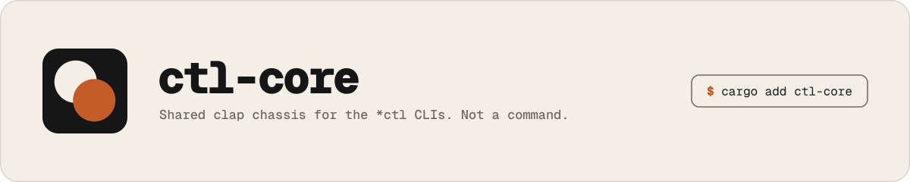

# ctl-core

<picture>
  <source media="(prefers-color-scheme: dark)" srcset="docs/banner-dark.svg">
  
</picture>

The shared Rust chassis for command-line programs such as `verctl`, `qctl`, `forkctl`, and `rawr`, and the terminal render engine it draws with.
Every crate here is a library, released together at one version.

| Crate | What it is | Docs |
|:--|:--|:--|
| [`ctl-text`](ctl-text/README.md) | Styled text that is safe to print, widths in terminal cells, and wrapping | [docs.rs](https://docs.rs/ctl-text) |
| [`ctl-layout`](ctl-layout/README.md) | Tables, records, rules, stacks, and indents built on `ctl-text` | [docs.rs](https://docs.rs/ctl-layout) |
| [`ctl-term`](ctl-term/README.md) | Colour, colour depth, and width for each output stream, and the escape encoder | [docs.rs](https://docs.rs/ctl-term) |
| [`ctl-core`](ctl-core/README.md) | The CLI chassis: shared flags, help, one result rendered as pretty or JSON output, and exit codes | [docs.rs](https://docs.rs/ctl-core) |

## How they fit

```text
ctl-text ──┬──→ ctl-layout ──┬──→ ctl-core
           └──→ ctl-term ────┘
```

`ctl-layout` and `ctl-term` each depend on `ctl-text`, and never on each other.
`ctl-core` depends on all three and re-exports them as `ctl_core::{text, layout, term}`.

A program built on ctl-core returns typed results, and ctl-core turns each result into a `Document`.
`ctl-layout` lays it out as lines of styled text.
`ctl-term` writes those lines with the colour and width the stream allows.
No escape byte exists before that last step, so JSON output and text from outside the program stay plain.

## Contributing

[`AGENTS.md`](AGENTS.md) holds the workspace rules and links each crate's own guide.
[`docs/presentation.md`](docs/presentation.md) describes how output is presented.
Changes are planned in [`openspec/`](openspec/) and released from [Changesets](.changeset/) fragments.

## License

MIT.
